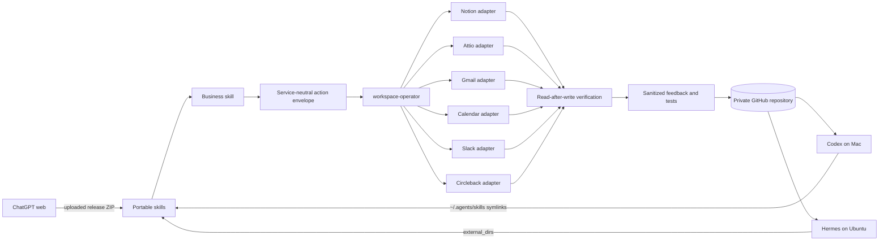

# Architecture

## Design principle

Business judgment belongs in portable skills. Service-specific access belongs in adapters. GitHub stores approved, sanitized operating knowledge. Local secret stores hold credentials. Human approval remains a first-class system input.

## Sources of truth

| Domain | Source of truth |
|---|---|
| Long-term account, prospect, and deal truth | Attio |
| Exhaustive meeting recording/transcript | Circleback |
| Internal work and operating documentation | Notion |
| Daily AE working cockpit | Notion Daily Call Logs |
| Email message state | Gmail |
| Schedule and event state | Google Calendar |
| Skill instructions, tests, config, decisions | Private GitHub repository |
| Secrets and tokens | Local secret store / connector auth, never Git |

## Runtime surfaces

### ChatGPT web

Best for connected cloud apps, interactive reasoning, approvals, and Personal Skills. Skills are uploaded releases. Git does not directly mount into ChatGPT web.

### Codex on the Mac

Best for editing, testing, reviewing, and packaging the repository. User skills are symlinked into `~/.agents/skills` so they always reflect the checked-out Git revision.

### Hermes on Ubuntu

Best for scheduled unattended workflows. Hermes reads the repository skills as an external skill directory and runs jobs in the repository workdir. It must stop safely when a required connector is unavailable.

## Learning loop

1. Collect accessible work and explicit feedback.
2. Classify facts, inference, decisions, corrections, and failures.
3. Update non-behavioral learning artifacts automatically.
4. Generate approval-required proposals for production behavior changes.
5. Validate schemas and tests.
6. Approve and merge.
7. Git auto-sync distributes the approved state to both computers.
8. Upload a reviewed release to ChatGPT web when desired.

## Git branches

The package begins with a single `main` branch because Ross is the only editor. As teammates join, use:

- protected `main`;
- one branch per change;
- pull requests with required validation;
- CODEOWNERS for high-risk skills and connector adapters; and
- signed or verified commits where practical.

## Separation of state

| State | Git? | Example |
|---|---:|---|
| Approved skill instructions | Yes | `skills/day-operator/SKILL.md` |
| Sanitized test cases | Yes | `skills/day-operator/tests/cases.json` |
| Change proposal | Yes | `proposals/*.md` |
| Connector credentials | No | `~/.hermes/.env`, OAuth store |
| Raw client document | No | Approved cloud system only |
| Raw transcript | No by default | Circleback |
| Sanitized learned rule | Yes | `decisions/`, `tests/` |
| Local sync logs | No | `~/.local/state/ai-os/` |
