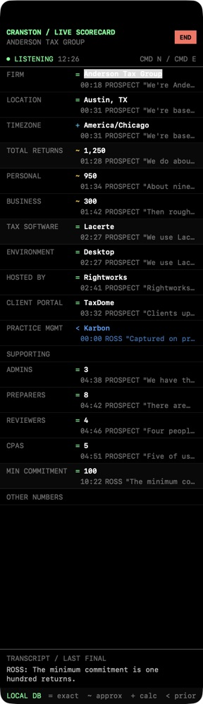

# Cranston Live Call Scorecard

A compact native macOS scorecard for Google Meet discovery calls. It captures Chrome audio and the local microphone as separate channels, transcribes both during the call, extracts structured facts, and keeps each value's exact supporting words available behind a compact disclosure control.

The app is intentionally a tall, narrow Mac window rather than a browser sidebar. It opens at one-sixth of the active screen width, stays above normal windows, and uses a dense 10-point terminal-style interface.



## What works

- Manual **New Meeting** and **End** controls.
- Google Chrome system-audio capture through ScreenCaptureKit.
- Separate microphone capture, so Ross and the prospect remain separate channels.
- Live English transcription through Apple's Speech framework.
- A **Words** view beside **End** that replaces the scorecard body with the full, auto-scrolling raw transcript during a meeting.
- A compact **Settings** panel beside **Raw Capture** with a saved microphone selector and live input-level meter.
- USB-interface capture that preserves integer/float and interleaved/planar PCM formats, including the Zoom H6's 48 kHz stereo input.
- Separate `ROSS` and `PROSPECT` live partials, so overlapping channel updates do not hide each other.
- Structured extraction through Apple's on-device Foundation Models framework.
- Deterministic fallback extraction when Apple Intelligence is unavailable.
- Fixed-order scorecard fields with direct inline editing.
- Up and Down arrow keys commit the current edit and move between scorecard fields in both live and saved calls.
- A compact `+` disclosure for the exact quote, speaker channel, timestamp, and confidence marker behind each captured value.
- Per-field value locks that persist for the matched prospect email and prevent automated updates until explicitly unlocked.
- Editable primary and supporting software vocabularies, with multiple supporting tools stored as one comma-separated value.
- Per-field speaker-source policies with visible blue `P | R | E` controls for Prospect only, Ross only, or either speaker. Manual entry remains available for every field independently of this policy.
- Current-event matching through macOS Calendar, using the external attendee email as a durable prospect identity.
- Manual email assignment when Calendar does not find the correct attendee; attendee name and business domain seed editable Name and Firm values.
- Prior facts isolated by exact external email address, including two people who share the same business domain.
- Personal plus business return calculation when no direct total was stated.
- US timezone calculation from a captured city and state.
- Prior-call values shown in blue until the new conversation changes them.
- Local SQLite persistence with no raw audio storage.
- Circleback webhook-transcript JSON import for post-call reconciliation.
- An idempotent Notion sync outbox created when a meeting ends.
- A searchable, newest-first Local DB call history with editable complete scorecards, correction labels, hidden evidence, and full transcripts.
- An Extraction Admin panel that visualizes the ordered rule pipeline, safe tunables, and accepted/rejected update decisions.

## Scorecard fields

1. Name
2. Firm
3. Location
4. Timezone
5. Total returns
6. Personal returns
7. Business returns
8. Primary tax software
9. Desktop, hosted, or cloud environment
10. Hosting provider
11. Client portal
12. Practice management
13. Supporting software
14. Admins
15. Preparers
16. Reviewers
17. CPAs
18. Annual commitment
19. Pilot commitment
20. Other numbers
21. Notes

The order never changes. Empty fields remain visible.

## Build

Requirements:

- Apple Silicon Mac
- macOS 26 or later
- Xcode 26 or later

From this directory:

```sh
./scripts/build-app.sh
```

The signed development bundle is created at:

```text
.build/Live Scorecard.app
```

The build prefers an available Developer ID Application identity, falls back to Apple Development, and signs with Hardened Runtime plus the Audio Input and Calendar entitlements. An Apple Development signature is appropriate for using and testing the app on this Mac. Distribution to other Macs requires a Developer ID Application certificate and Apple notarization.

Open that app normally from Finder. For a populated visual demo:

```sh
.build/Live\ Scorecard.app/Contents/MacOS/LiveScorecard --demo
```

## First-run permissions

Click **New Meeting** and approve:

- Speech Recognition
- Microphone
- Screen & System Audio Recording
- Calendar

If macOS reports a denial, open **System Settings > Privacy & Security**, enable Live Scorecard in the relevant sections, quit the app, and reopen it. A restart after granting Screen & System Audio Recording may be required.

### Permission is enabled but the app still says Manual Mode

The privacy grant is tied to the app's code-signing identity, not only its name and bundle ID. An ad-hoc signature changes whenever the executable is rebuilt, which can leave a visible but stale `Live Scorecard` permission row.

Quit Live Scorecard completely, then reset its four capture-related records:

```sh
tccutil reset ScreenCapture ai.cranston.live-scorecard
tccutil reset AudioCapture ai.cranston.live-scorecard
tccutil reset Microphone ai.cranston.live-scorecard
tccutil reset SpeechRecognition ai.cranston.live-scorecard
```

Reopen the same app bundle, click **New Meeting**, approve the new prompt, quit Live Scorecard with `Command-Q`, and open it once more. Do not rebuild or replace the bundle between granting permission and reopening it.

For a permanent development setup, add an Apple Development certificate in **Xcode > Settings > Accounts > Manage Certificates**. The build script automatically uses an available Apple Development or Developer ID Application identity. You can also select an identity explicitly:

```sh
LIVE_SCORECARD_SIGNING_IDENTITY="Apple Development: Your Name" ./scripts/build-app.sh
```

When no stable identity is available, the build still succeeds but prints a warning that the privacy grant may need to be reset after rebuilding.

## Call workflow

1. Open Google Meet in Chrome.
2. Open Live Scorecard.
3. Click **New Meeting** or press `Command-N`. The app checks the active calendar event before capture starts.
4. Keep other Chrome tabs quiet because the first version captures Chrome application audio, not one specific tab.
5. Refer to the fixed scorecard during the call.
6. Click **Words** to inspect exactly what each audio channel is hearing. Click **Card** to return without losing the scorecard or transcript.
7. In **Words**, click **Settings** beside **Raw Capture**. Select the intended microphone and confirm the meter says `SIGNAL` while you speak. `NO DATA`, `SILENT`, and `OFF` distinguish capture problems from transcript-processing problems.
8. Edit any value directly in its single-line field when needed. When the call has a calendar identity, a padlock persists for that organization and is restored on its future calls.
9. Click **End** or press `Command-E`.

The status must say `LISTENING`. If it says `MANUAL MODE`, the visible error explains which permission or capture step failed. Manual editing remains available.

The app keeps microphone and Chrome audio as separate `ROSS` and `PROSPECT` channels. In the visible Words view they are abbreviated to green `R` and blue `P` to preserve horizontal space. Final segments include timestamps. In-progress speech is marked `LIVE` and ends with an ellipsis; it is replaced by the finalized segment when Apple Speech finalizes it. This makes it possible to distinguish an audio/transcription failure from a downstream fact-extraction failure.

## Google Calendar prospect identity

Live Scorecard reads events through Apple's native Calendar framework. In **System Settings > Internet Accounts > Google**, make sure **Calendars** is enabled for the Google account that owns the sales calendar. Approve the Calendar permission when Live Scorecard requests it.

When **New Meeting** is clicked, the app finds the timed event happening now, ignores Ross and other `@cranston.ai` attendees, and resolves one external prospect identity:

- a business address such as `owner@northwindtax.com` becomes `domain:northwindtax.com`, so different people at the same organization share prior facts;
- a personal-provider address such as Gmail or Outlook becomes the complete email address, so unrelated personal-email prospects never share facts;
- internal-only, missing, or ambiguous overlapping events display `NO CAL ID` and deliberately load no blue prior facts.

The matched calendar event title becomes the local call title. Its identity and attendee email are stored only in the local SQLite database and appear in Local DB call detail. On the next event with the same identity, the most recent facts for that identity populate in blue. Firm-name extraction no longer controls carry-forward.

Meetings recorded before this identity migration remain in Local DB but have no calendar identity and are not automatically treated as prior evidence for a new prospect.

## H6 and USB audio diagnostics

The app reads the selected input's active hardware format and converts integer or floating-point, interleaved or planar PCM into an owned mono speech buffer. For a stereo USB input, the louder active channel is selected so a microphone routed only to the H6's left or right side still works.

The Settings panel reports the detected format and distinguishes:

- `NO DATA`: ScreenCaptureKit did not deliver decodable microphone buffers.
- `SILENT`: buffers arrived and decoded, but the USB route contains silence.
- `SIGNAL`: decoded microphone energy is present.
- `OFF`: capture is not running.

If H6 says `SILENT` while its own input meter moves, check the H6's `INPUT&OUTPUT > Mixer`. In Stereo Mix mode, the H6 can meter an input before a muted or lowered USB mix prevents it from reaching the Mac.

## Local call history

When no meeting is running, click **Local DB** in the footer. Search matches meeting titles, firm names, transcript speakers and words, fact values, and supporting quotes. Select a call to view its fixed-order facts and complete chronological transcript, use `< BACK` to return to the result list, or click **Local DB** again to close either screen.

## Extraction Admin

When no meeting is running, click **Admin** in the footer. The Rules tab shows the exact order of evidence, pattern, model, replacement, and inference rules. Safe controls tune the context window, model use, deterministic-rule priority, and replacement guards.

The **Software Vocabulary** editors accept comma- or line-separated names. Primary tax software and supporting software have separate lists. When a finalized transcript segment contains several configured supporting tools, the app keeps every distinct name in spoken order and displays them separated by commas.

The **Apple Intelligence Rules** editor appends local instructions to the fixed evidence-safe model prompt. Custom instructions cannot disable the exact-quote requirement or make a number in an unanswered question count as a fact.

Each field has one update policy:

- `LATEST`: newer supported evidence can replace the value;
- `CONFIRM`: a blue prior-call value needs a direct statement, and a value already captured in this call needs explicit correction or confirmation language;
- `KEEP`: once populated, only a manual edit can change the value.

`TOTAL RETURNS` defaults to `CONFIRM`. The Trace tab explains which proposed values were accepted, rejected, replaced, merged, inferred, or left unchanged and shows the supporting quote when available.

### Improving extraction accuracy

Apple's system language-model weights are not retrained by Live Scorecard after one call. Manual edits also do not silently teach the model. Accuracy improves in controlled ways: expand the editable vocabularies, add a concise custom instruction, inspect rejected and accepted candidates in Trace, and turn recurring errors into deterministic rules and regression tests. Preserve the final transcript, the app's extracted values, and the corrected values from a test call; that comparison is the evidence needed to improve the prompt or pattern without training on a mistaken correction.

## Confidence markers

| Marker | Meaning |
|---|---|
| `=` | Directly stated |
| `~` | Approximate or normalized vague quantity |
| `+` | Calculated, including total returns or timezone |
| `*` | Manually entered |
| `<` | Carried forward from a prior call |
| `!` | Conflicting evidence |

Numbers appearing only in questions are ignored. Direct corrections replace the current value rather than creating a visible value history. "About 800" displays as `800`; an explicit range remains a range; "a few hundred" displays as approximate `200`, following the requested rule.

## Storage

Production data is stored at:

```text
~/Library/Application Support/Cranston Live Scorecard/scorecard.sqlite3
```

Tables:

- `meetings`
- `prospects`
- `prospect_field_locks`
- `transcript_segments`
- `facts`
- `sync_outbox`

The app does not save audio. Transcript segments and their extracted evidence are saved locally.

## Circleback reconciliation

Circleback's supported webhook sends the completed transcript after a meeting. Save that webhook JSON and choose **File > Import Circleback Transcript…** while the corresponding scorecard is open. The importer accepts Circleback's documented transcript objects:

```json
{
  "id": "meeting-id",
  "name": "Meeting name",
  "transcript": [
    {"speaker": "Ross Gates", "text": "The minimum is 100 returns.", "timestamp": 30.0},
    {"speaker": "Prospect Name", "text": "We file 900 returns.", "timestamp": 45.0}
  ]
}
```

The import re-runs extraction against the finalized transcript and updates the current facts.

## Notion status

Ending a meeting writes one idempotent payload to `sync_outbox` with status `awaiting_configuration`.

Automatic Notion transmission is deliberately not enabled yet. The AI Operating System's Notion adapter is not configured, and the exact target database ID, schema, and credential path have not been supplied. Activating a generic write without those values would risk creating records in the wrong database. The outbox preserves the completed payload so the connector can be added without changing the live app or reprocessing a meeting.

## Tests

```sh
env \
  CLANG_MODULE_CACHE_PATH=/tmp/live-scorecard-clang-cache \
  SWIFT_MODULECACHE_PATH=/tmp/live-scorecard-swift-cache \
  SWIFTPM_CONFIG_DIR=/tmp/live-scorecard-swiftpm \
  swift test --scratch-path .build --disable-sandbox
```

The current suite covers:

- rejection of numbers contained only in questions;
- return and staff-role extraction;
- vague-number normalization;
- calculated totals;
- direct-total precedence;
- timezone resolution;
- supporting-software deduplication;
- editable primary/supporting software recognition and multi-tool spoken ordering;
- separate simultaneous microphone and meeting-audio partials;
- partial-to-final transcript handoff without losing the final segment;
- microphone level normalization at silence, midpoint, and full scale;
- H6-shaped stereo interleaved integer PCM conversion and active-channel selection;
- history ordering, search, and complete call-detail loading;
- calendar attendee identity matching and ambiguity rejection;
- prospect-isolated prior facts and identity/email history search;
- persistent prospect field locks;
- extraction configuration bounds, custom model instructions, field policies, disabled rules, and replacement decisions;
- correction replacement;
- SQLite persistence; and
- Circleback transcript parsing and ordering.

## Known boundaries

- Circleback and Granola do not document a supported live transcript API. This app captures the audio directly instead.
- All remote Google Meet voices are labeled `PROSPECT` in the live feed. Individual remote-speaker diarization is deferred.
- The first version captures all Chrome audio. Do not play unrelated audio in another Chrome tab during a call.
- The timezone resolver covers common US locations. Split-timezone states may require a city or manual correction.
- The 15-second update objective depends on speech finalization and local model availability. Long uninterrupted speech may finalize later.
- Apple Intelligence improves general extraction. If it is disabled or the model is not ready, the deterministic extractor still handles common return, staffing, software, environment, location, and commitment statements.
- Automatic Circleback webhook reception, Notion delivery, Attio writes, and individual prospect diarization are later integrations.
- Google Calendar events must be visible to the macOS Calendar database through **System Settings > Internet Accounts**. Direct Google OAuth is not required in this version.
